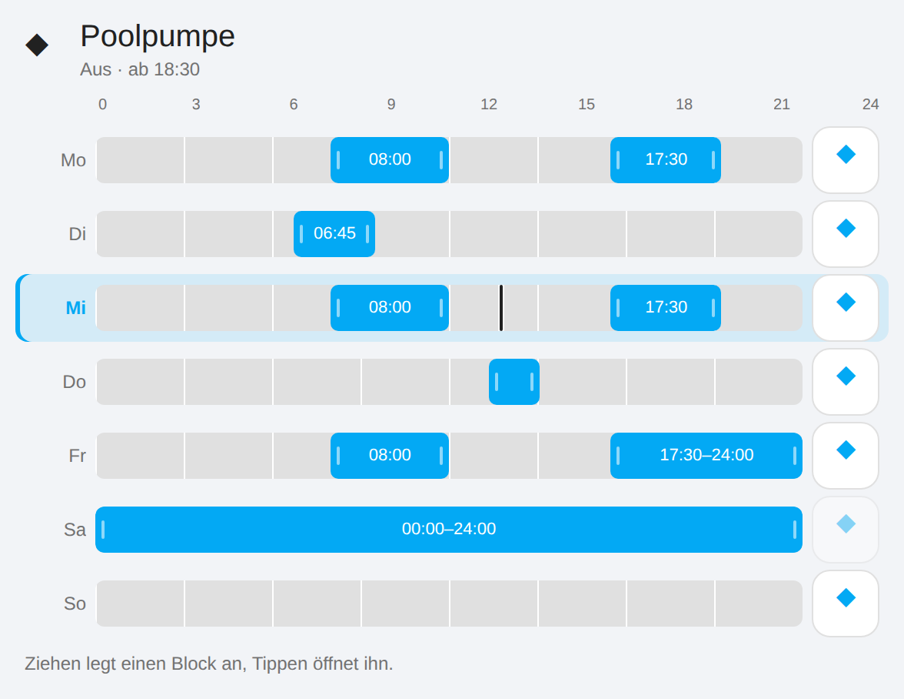
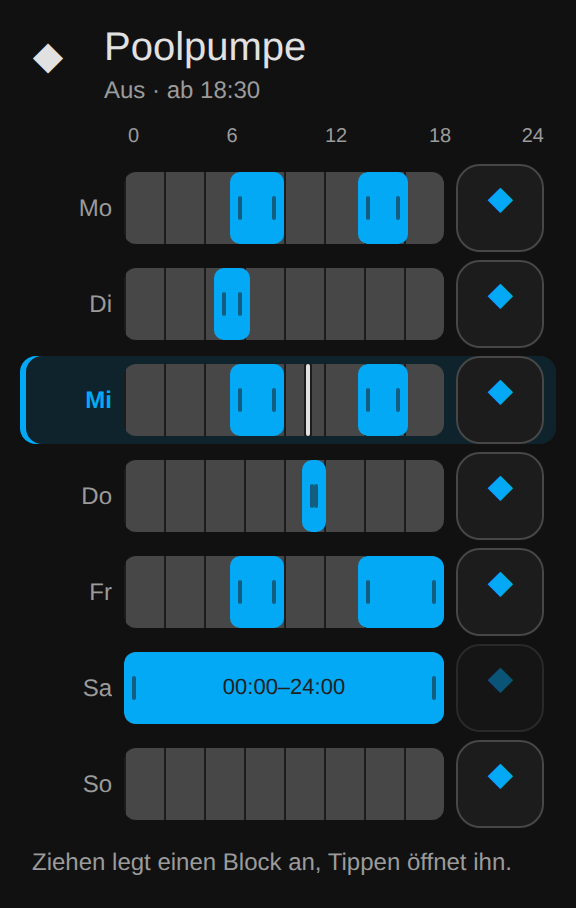

# Busch Cards

[](https://hacs.xyz/)
[](https://github.com/luukkii123/ha-busch-cards/releases)
[](LICENSE)

Eine Sammlung von Lovelace-Karten für Home Assistant in **einer** Datei
(`busch-cards.js`, ohne Abhängigkeiten): Zeitplan, Landkarte, Kalender,
Geräteübersicht, dynamische Entity-Auswahl, drei Unraid-Karten und zwei
Netzwerkkarten. Alle Karten haben einen grafischen Editor (Deutsch/Englisch) und
folgen dem gewählten Theme in hell und dunkel.

Benötigt Home Assistant **2026.9.3** oder neuer.

| Karte | Wofür |
| --- | --- |
| [`busch-schedule-card`](#busch-schedule-card) | Zeitplan-Helfer direkt im Dashboard bearbeiten |
| [`busch-map-card`](#busch-map-card) | die eingebaute Karte, nur mit anderen Kacheln |
| [`busch-calendar-card`](#busch-calendar-card) | Termine eines Monats als Tagesliste |
| [`busch-device-card`](#busch-device-card) | ein Gerät samt Entitäten |
| [`busch-smart-entities`](#busch-smart-entities) | dynamische Filter, die eine Zielkarte befüllen |
| [`busch-unraid-stack-card`](#busch-unraid-stack-card) | Compose-Stack mit Containersteuerung und Updates |
| [`busch-unraid-container-card`](#busch-unraid-container-card) | einzelner Container |
| [`busch-unraid-vm-card`](#busch-unraid-vm-card) | virtuelle Maschine |
| [`busch-network-card`](#busch-network-card) | Netzwerkgeräte aus `device_tracker` |
| [`busch-fritz-device-card`](#busch-fritz-device-card) | FRITZ!-Router oder -Repeater samt Clients |

## Installation

**Über HACS:**

1. HACS → ⋮ → **Benutzerdefinierte Repositories**
2. Repository `https://github.com/luukkii123/ha-busch-cards`, Kategorie **Dashboard**
3. **Busch Cards** herunterladen und die Seite neu laden (Strg+F5)

HACS trägt die Ressource selbst ein (`/hacsfiles/ha-busch-cards/busch-cards.js`,
Typ *JavaScript-Modul*).

**Manuell:** `dist/busch-cards.js` nach `<config>/www/busch-cards.js` kopieren und
unter Einstellungen → Dashboards → ⋮ → **Ressourcen** als
`/local/busch-cards.js` (Typ *JavaScript-Modul*) eintragen.

Danach erscheinen die Karten in der Kartenauswahl, mit Vorschau und Editor.

---

# `busch-schedule-card`

Bearbeitet einen Zeitplan-Helfer (`schedule.*`) direkt im Dashboard: Blöcke
ziehen, verschieben, vergrößern, kopieren. Gespeichert wird sofort; schlägt das
fehl, springt die Karte auf den letzten bestätigten Stand zurück.



**Voraussetzung:** ein `schedule`-Helfer, der über die Oberfläche angelegt wurde.
In YAML festgelegte Zeitpläne (`editable: false`) werden nur angezeigt.

```yaml
type: custom:busch-schedule-card
entity: schedule.pool_zeitplan
title: Poolpumpe
```

| Schlüssel | Typ | Vorgabe | Bedeutung |
| --- | --- | --- | --- |
| `entity` | Text | — (Pflicht) | eine `schedule.*`-Entität |
| `title` | Text | Name der Entität | Überschrift |
| `icon` | Text | Symbol der Entität, sonst `mdi:calendar-clock` | Symbol links neben der Überschrift |
| `first_day` | `auto` \| `monday` \| `sunday` | `auto` | Wochenanfang; `auto` folgt Home Assistant |
| `step` | Zahl 1–60 | `15` | Raster beim Ziehen in Minuten (der Editor bietet 5–60 in Fünferschritten) |
| `highlight_today` | ja/nein | `true` | hebt den heutigen Wochentag hervor und zeigt die aktuelle Uhrzeit als Linie; folgt der in Home Assistant eingestellten Zeitzone |
| `read_only` | ja/nein | `false` | sperrt Ziehen, Anlegen, Bearbeiten und Löschen auf dieser Karte |

**Bedienung:** auf freie Fläche ziehen legt einen Block an, tippen einen Block
über eine Stunde. Block ziehen verschiebt ihn, am Rand ziehen ändert Anfang oder
Ende, antippen öffnet den Dialog (Von/Bis, Löschen). Ein Wochentag lässt sich
leeren oder auf alle Tage, Mo–Fr oder Sa+So kopieren. Blöcke und Plus-Schaltflächen
sind per Tastatur erreichbar. Blöcke dürfen sich berühren, aber nicht überlappen;
ein Block darf bis 24:00 laufen. Das freie Feld `data` je Block bleibt erhalten,
wird aber nicht angezeigt.



Der Umbruch hängt an der Kartenbreite, nicht an der Fenstergröße: eine schmale
Spalte verhält sich wie ein Handy.

### Nur am Handy schreibgeschützt

`read_only` gilt je Karte. Wer nur auf dem Handy gegen versehentliche Änderungen
sperren will, legt die Karte zweimal an und blendet sie per Sichtbarkeitsbedingung
„Bildschirm“ aus bzw. ein:

```yaml
type: vertical-stack
cards:
  - type: conditional
    conditions:
      - condition: screen
        media_query: "(max-width: 767px)"
    card:
      type: custom:busch-schedule-card
      entity: schedule.pool_zeitplan
      read_only: true
  - type: conditional
    conditions:
      - condition: screen
        media_query: "(min-width: 768px)"
    card:
      type: custom:busch-schedule-card
      entity: schedule.pool_zeitplan
```

### Aussehen

Die Karte nutzt HA-Variablen. Zusätzlich gibt es zwei Variablen, die im **Theme**
gesetzt werden:

| Variable | Vorgabe | Wirkung |
| --- | --- | --- |
| `--busch-schedule-color` | `--primary-color` | Farbe der Blöcke |
| `--busch-schedule-track-color` | `--divider-color` | Hintergrund der Tagesspur |

```yaml
# im Theme
busch-schedule-color: "#e65100"
busch-schedule-track-color: "#37474f"
```

---

# `busch-map-card`

Die **eingebaute Map-Karte von Home Assistant mit anderen Kacheln**. Aus einer
bestehenden Karte wird sie, indem man nur den Typ tauscht; alle Optionen der
eingebauten Karte (`entities`, `hours_to_show`, `default_zoom`, `focus` …)
gelten unverändert.

```yaml
type: custom:busch-map-card
entities:
  - person.beispiel
map_style: carto
```

| Schlüssel | Typ | Vorgabe | Bedeutung |
| --- | --- | --- | --- |
| `map_style` | Auswahl | `carto` | Kachelvorlage, siehe unten |
| `tile_url` | Text | leer | eigene Kachel-URL mit Platzhaltern für Zoom, Spalte, Zeile; nur bei `map_style: custom` |
| `tile_url_dark` | Text | leer | URL für das dunkle Theme; leer heißt: die helle gilt auch dunkel |
| `tile_attribution` | Text | leer | Quellenangabe unten rechts; bei eigener URL Pflicht der meisten Anbieter |
| `tile_max_zoom` | Zahl 1–22 | `19` | größte Zoomstufe der eigenen Kachelquelle; nur bei `custom` |
| `tile_api_key` | Text | leer | Kachelschlüssel nur für diese Karte; überschreibt den Helfer |
| `tile_api_key_entity` | `input_text.*` | `input_text.carto_api_key` | Helfer, in dem der Schlüssel steht |
| `theme_mode` | `auto` \| `light` \| `dark` | `auto` | hell/dunkel, wie bei der eingebauten Karte |

| `map_style` | Karte | hell/dunkel |
| --- | --- | --- |
| `ha` | Home-Assistant-Standard, Kacheln unangetastet | — |
| `osm` | OpenStreetMap | nur hell |
| `carto` | CARTO Positron / Dark Matter | beides |
| `voyager` | CARTO Voyager | beides |
| `satellite` | Esri World Imagery | nur hell |
| `topo` | OpenTopoMap | nur hell |
| `custom` | eigene URL | beides |

**CARTO braucht einen Schlüssel.** Ohne ihn steht „API KEY REQUIRED“ quer in den
Kacheln. Einen kostenlosen Schlüssel gibt es unter
[carto.com/basemaps/apikey](https://carto.com/basemaps/apikey). Er wird einmal im
System hinterlegt: Einstellungen → Geräte & Dienste → Helfer → **Text**, Name
**CARTO API Key** (ergibt `input_text.carto_api_key`), Modus **Passwort**. Alle
Karten lesen ihn von dort. Kachelschlüssel sind für jeden sichtbar, der das
Dashboard öffnen kann; beim Anbieter auf die eigene Domain einschränken. `osm`,
`satellite` und `topo` brauchen keinen Schlüssel.

Die Quellenangabe setzt die Karte für die mitgelieferten Vorlagen selbst; bei
eigener URL trägst du sie ein und prüfst die Nutzungsbedingungen des Anbieters.
Der OpenStreetMap-Kachelserver ist für den Hausgebrauch gedacht, nicht für
Dauerlast. Greift die Karte nicht auf die interne Karte von Home Assistant zu,
fällt sie auf deren normale Kacheln zurück.

---

# `busch-calendar-card`

Zeigt die Termine eines **Kalendermonats als Tagesliste** – eine Zeile je Tag,
chronologisch, kein Wochenraster. Gedacht für Dienst- und Arbeitszeiten. Ein
Klick auf einen Termin öffnet den Termin-Dialog von Home Assistant (Neue Termine
legt die Karte nicht an).

**Voraussetzung:** mindestens eine `calendar.*`-Entität.

```yaml
type: custom:busch-calendar-card
title: Arbeitszeit
entities:
  - calendar.arbeitszeiten
month_offset: -1
show_total: true
```

| Schlüssel | Typ | Vorgabe | Bedeutung |
| --- | --- | --- | --- |
| `entities` | Liste | leer | Kalender: `calendar.x` oder `{entity: calendar.x, color: "#hex"}` |
| `month_offset` | Ganzzahl −24…24 | `0` | Startmonat; `-1` Vormonat, `1` Folgemonat |
| `title` | Text | leer | Überschrift über dem Monatsnamen |
| `navigation` | ja/nein | `true` | Pfeile zum Blättern (ändert die Konfiguration nicht) |
| `show_empty_days` | ja/nein | `true` | Tage ohne Termin als leere Zeile zeigen |
| `show_total` | ja/nein | `false` | Fußzeile mit Tagen, Stunden und Anzahl ganztägiger Termine |
| `open_event_on_tap` | ja/nein | `true` | Klick auf eine Zeile öffnet den Termin |
| `edit_on_tap` | ja/nein | `true` | Klick öffnet gleich den Editor statt der Ansicht |
| `read_only` | ja/nein | `false` | Klick öffnet nur die Ansicht des Termins, ohne Bearbeiten und Löschen |

Jeder Kalender bekommt automatisch eine Farbe; ab dem zweiten Kalender gibt es im
Editor je Kalender einen Farbwähler. Ganztägige Termine gehen nicht in die
Stundensumme ein.

---

# `busch-device-card`

Gib der Karte ein Gerät oder irgendeine Entität des Geräts: sie zeigt Name,
Hersteller, Modell und Bereich. Zugeklappt bleibt es dabei; aufgeklappt erscheint
die Tile-Karte von Home Assistant mit passenden Bedienelementen und darunter alle
übrigen Entitäten des Geräts, gruppiert wie auf der Geräteseite (Steuerung,
Sensoren, Konfiguration, Diagnose).

```yaml
type: custom:busch-device-card
entity: light.wohnzimmer_decke
```

| Schlüssel | Typ | Vorgabe | Bedeutung |
| --- | --- | --- | --- |
| `device_id` | Text | — | Gerät direkt wählen (statt `entity`) |
| `entity` | Text | — | Hauptentität; das Gerät wird daraus gefunden |
| `title` | Text | Gerätename | Überschrift |
| `template` | `auto` \| `light` \| `climate` \| `cover` \| `fan` \| `media` \| `lock` \| `switch` \| `generic` | `auto` | Bedienelement oben; `auto` richtet sich nach der Domain |
| `labels` | Liste | alle | zeigt nur Entitäten mit einem dieser Labels |
| `labels_hide` | Liste | keine | verbirgt Entitäten mit diesen Labels; schlägt `labels` |
| `filter` | Objekt | keine Regeln | Include-/Exclude-Regeln (siehe [Filterregeln](#filterregeln-in-smart-entities)) |
| `groups` | Liste | alle vier | welche Gruppen erscheinen: `control`, `sensor`, `config`, `diagnostic` |
| `groups_open` | Liste | `[control]` | welche Gruppen offen starten |
| `show_subtitle` | ja/nein | `true` | Hersteller · Modell · Bereich unter dem Namen |
| `start_expanded` | ja/nein | `false` | Karte startet aufgeklappt |
| `quick_controls` | ja/nein | `false` | direkte Steuerung in der Kopfzeile, auch zugeklappt |
| `display_mode` | `auto` \| `image` \| `icon` | `auto` | Medienanzeige der Kopfzeile |
| `image` | Text | leer | eigene Bildadresse |
| `icon` | Text | automatisch | eigenes `mdi:`-Symbol, auch Ersatz bei Bildfehlern |
| `tap_action` | Aktion | aufklappen | Tippen auf die Kopfzeile |
| `hold_action` | Aktion | Details öffnen | Halten auf der Kopfzeile |
| `row_tap_action` | Aktion | Details öffnen | Tippen auf eine Entitätenzeile |
| `row_hold_action` | Aktion | nichts | Halten auf einer Zeile |

**Aktionen** nutzen die Aktionsform von Home Assistant (`more-info`, `toggle`,
`navigate`, `url`, `perform-action`, `none`); zusätzlich bei Kopfzeile und Halten
`expand` (auf-/zuklappen) und `device-page` (Geräteseite). In `target` und `data`
werden `{{ entity }}`, `{{ device }}` und `{{ area }}` ersetzt (kein Jinja).
`assist` und `confirmation` werden nicht unterstützt.

```yaml
type: custom:busch-device-card
device_id: YOUR_DEVICE_ID
filter:
  exclude:
    - state: unavailable
    - state: unknown
tap_action:
  action: perform-action
  perform_action: label.add
  target:
    entity_id: "{{ entity }}"
  data:
    label_id: geprueft
```

---

# `busch-smart-entities`

Filtert Entitäten dynamisch und befüllt damit eine beliebige Zielkarte. Eine
bestehende `auto-entities`-Konfiguration lässt sich übernehmen, indem man den Typ
auf `custom:busch-smart-entities` ändert. Zusätzlich kann die Karte pro Ergebnis
eine eigene Karte erzeugen (`item`).

```yaml
type: custom:busch-smart-entities
card:
  type: entities
filter:
  include:
    - domain: sensor
      attributes:
        device_class: battery
      state: "< 20"
sort:
  method: state
  numeric: true
```

| Schlüssel | Typ | Vorgabe | Bedeutung |
| --- | --- | --- | --- |
| `filter` | Objekt | keine | `include`, `exclude` (Regellisten) und `template` (Jinja). Mindestens `filter` oder `entities` ist nötig |
| `entities` | Liste | keine | feste Entitäten vor den Treffern |
| `card` | Objekt | `{type: entities}` | Zielkarte; `card.type` bestimmt den Typ |
| `card_param` | Text | `entities` | Parameter der Zielkarte, der die Treffer erhält |
| `item` | Karte | keine | Vorlage: pro Ergebniswert eine eigene Karte; braucht `item_param` |
| `item_param` | Text (Objektpfad) | — | Pfad in `item`, in den der Wert kommt, z. B. `entity`, `device_id`, `config.target` |
| `value` | Objekt | Entitätszeilen | Wertausgabe statt Zeilen: `type` (`entity_id` \| `device_id` \| `attribute`), `attribute` (Pfad), `missing` (`skip` \| `null`, Vorgabe `skip`) |
| `unique_values` | ja/nein | `false` | gleiche ausgegebene Werte nur einmal |
| `unique` | `true` \| `entity` | aus | ganze Zeilen bzw. Entity-IDs entdoppeln (wie auto-entities) |
| `sort` | Objekt | unsortiert | `method`, `attribute`, `reverse`, `ignore_case`, `numeric`, `ip`, `first`, `count` |
| `else` | Karte | keine | Karte bei leerem Ergebnis |
| `show_empty` | ja/nein | `true` | bei `false` wird die Karte ohne Treffer ausgeblendet |
| `debug` | ja/nein | `false` | zeigt Kandidaten, Laufzeit und erzeugte Konfiguration |

`sort.method`: `none`, `domain`, `entity_id`, `name`, `device`, `device_name`,
`area`, `state`, `attribute`, `last_changed`, `last_updated`, `last_triggered`.
`sort.first` ist der Startindex (0), `sort.count` die maximale Trefferzahl.

### Filterregeln in Smart Entities

Mehrere Schlüssel einer Regel sind UND-verknüpft, mehrere `include`-Einträge
ODER-verknüpft; `exclude` hat Vorrang. Werte unterstützen Wildcards, reguläre
Ausdrücke und Vergleiche (`"< 20"`, `"!= off"`).

| Regel | Bedeutung |
| --- | --- |
| `domain`, `entity_id`, `name`, `state` | Domain, Entity-ID, Anzeigename, Zustand |
| `group`, `area`, `floor`, `level` | Gruppe, Bereich, Etage, Stockwerk |
| `device`, `device_manufacturer`, `device_model` | Gerät, Hersteller, Modell |
| `label`, `integration`, `hidden_by`, `entity_category` | Label, Integration, verborgen durch, Kategorie |
| `attributes` | Attribute (auch verschachtelt) |
| `last_changed`, `last_updated`, `last_triggered` | Zeitvergleich, z. B. `"> 2 h"` |
| `and`, `or`, `not` | Verschachtelung |
| `options`, `type`, `sort` | Zeilenoptionen, feste Zeile, lokale Sortierung (nur in Smart Entities) |

**Eine Karte pro Ergebnis:**

```yaml
type: custom:busch-smart-entities
filter:
  include:
    - state: unavailable
value:
  type: device_id
unique_values: true
sort:
  method: device_name
  count: 6
card:
  type: vertical-stack
card_param: cards
item:
  type: custom:busch-device-card
  groups_open: []
item_param: device_id
```

---

# Unraid-Karten

Die drei Karten setzen die Home-Assistant-Integration **`unraid_ssh`** voraus und
werden über `device_id` an ein Gerät der Integration gebunden (im Editor
auswählen). Stoppen und Neustarten werden standardmäßig bestätigt. Ist die
Zuordnung nicht eindeutig, bleiben die Steuerungen aus Sicherheitsgründen
gesperrt. Ein Update-Fortschritt erscheint nur, wenn das Backend echte Werte
liefert (Unraid-SSH 0.7.0 oder neuer für die Warteschlange).

Gemeinsame Schlüssel (S = Stack, C = Container, V = VM):

| Schlüssel | Typ | Vorgabe | S | C | V | Bedeutung |
| --- | --- | --- | :-: | :-: | :-: | --- |
| `device_id` | Text | — | ja | ja | ja | Unraid-Gerät (Modell *Compose stack*, *Docker container* bzw. *Virtual machine*) |
| `title` | Text | Gerätename | ja | ja | ja | Titel |
| `layout` | `compact` \| `detailed` | `detailed` | ja | ja | ja | Ansicht |
| `show_status` | ja/nein | `true` | ja | ja | ja | Zustand anzeigen |
| `show_controls` | ja/nein | `true` | ja | ja | ja | Start/Stopp anzeigen |
| `show_restart` | ja/nein | `true` | ja | ja | ja | Neustart anzeigen (nur mit nativem Backend-Button) |
| `confirm_stop` | ja/nein | `true` | ja | ja | ja | vor dem Stoppen nachfragen |
| `confirm_restart` | ja/nein | `true` | ja | ja | ja | vor dem Neustart nachfragen |
| `show_updates` | ja/nein | `true` | ja | ja | — | verfügbare Updates anzeigen |
| `display_mode` | `auto` \| `image` \| `icon` | `auto` | — | ja | ja | Bild oder Symbol |
| `image` | Text | leer | — | ja | ja | eigene Bildadresse |
| `icon` | Text | leer | — | ja | ja | eigenes `mdi:`-Symbol |
| `show_cpu` | ja/nein | `true` | — | ja | ja | CPU (Prozent je Kern, auch über 100 %) |
| `show_ram` | ja/nein | `true` | — | ja | ja | RAM (Balken nur mit Limit) |
| `debug` | ja/nein | `false` | — | ja | ja | Zuordnung anzeigen |

## `busch-unraid-stack-card`

Compose-Stack mit laufenden Containern, Stacksteuerung und zugeordneten Updates.

| Schlüssel | Typ | Vorgabe | Bedeutung |
| --- | --- | --- | --- |
| `show_containers` | ja/nein | `true` | Containerliste zeigen |
| `state_filter` | `all` \| `running` \| `stopped` | `all` | Liste filtern |
| `sort` | `name` \| `state` | `name` | Container sortieren |
| `start_expanded` | ja/nein | `true` | Liste aufgeklappt |
| `switch_entity` | Text | automatisch | Schalter bei älterem Backend ausdrücklich wählen |

```yaml
type: custom:busch-unraid-stack-card
device_id: YOUR_STACK_DEVICE_ID
```

## `busch-unraid-container-card`

Einzelner Standalone- oder Compose-Container.

| Schlüssel | Typ | Vorgabe | Bedeutung |
| --- | --- | --- | --- |
| `container_key` | Text | der einzige Container | Container, wenn das Gerät mehrere hat |
| `switch_entity` | Text | automatisch | Schalter bei älterem Backend ausdrücklich wählen |
| `update_entity` | Text | automatisch | Update-Entität bei älterem Backend ausdrücklich wählen |

```yaml
type: custom:busch-unraid-container-card
device_id: YOUR_DEVICE_ID
container_key: YOUR_CONTAINER_KEY
```

## `busch-unraid-vm-card`

Virtuelle Maschine mit CPU/RAM. **Herunterfahren** fordert den Gast zum
geordneten Ausschalten auf; **Sofort ausschalten** (Unraid-SSH 0.6.1 oder neuer)
fragt immer mit Datenverlustwarnung nach und wird nie automatisch ausgelöst.

| Schlüssel | Typ | Vorgabe | Bedeutung |
| --- | --- | --- | --- |
| `show_uptime`, `show_ip`, `show_disk` | ja/nein | `true` | Metriken; werden ausgeblendet, solange das Backend keine verlässlichen Gastdaten liefert |

```yaml
type: custom:busch-unraid-vm-card
device_id: YOUR_VM_DEVICE_ID
```

---

# Netzwerkkarten

Beide Karten zeigen Clients aus `device_tracker`-Entitäten (Vorgabe
`source_type: router`) mit Filter, Sortierung und optionalen Aktionen
(Internetzugang, Wake-on-LAN, Umbenennen, Labels über die Entity Registry;
Umbenennen und Labels brauchen Administratorrechte). Die Karten enthalten keine
Zugangsdaten.

Gemeinsame Schlüssel (N = Netzwerkkarte, F = FRITZ!-Karte):

| Schlüssel | Typ | Vorgabe | Gilt für | Bedeutung |
| --- | --- | --- | :-: | --- |
| `title` | Text | — | N F | Titel |
| `config_entry_id` | Text | — | N F | Integrationseintrag einschränken bzw. bei mehreren wählen |
| `display_mode` | `auto` \| `image` \| `icon` | `auto` | N F | Bild oder Symbol |
| `image`, `icon` | Text | — | N F | eigenes Bild / `mdi:`-Symbol |
| `layout` | `compact` \| `detailed` | `detailed` | N F | Ansicht |
| `count` | Ganzzahl ≥ 0 | `20` | N F | anfangs sichtbare Clients |
| `columns` | 1–3 | `1` | N F | Spalten der Clientliste |
| `show_header`, `show_status`, `show_details`, `show_controls`, `show_empty` | ja/nein | `true` | N F | Bereiche ein-/ausblenden |
| `start_expanded` | ja/nein | `true` | N F | Clientliste aufgeklappt |
| `include_unavailable` | ja/nein | `true` | N F | Clients mit `unknown`/`unavailable` einschließen |
| `show_ip`, `show_mac`, `show_hostname`, `show_network_device` | ja/nein | `true` | N F | Clientfelder |
| `show_last_changed`, `show_last_time_reachable` | ja/nein | `true` | N F | Zeitangaben |
| `time_fallback` | ja/nein | `false` | N F | ersatzweise Zustandsänderung anzeigen, wenn „zuletzt erreichbar“ fehlt |
| `show_internet`, `show_wol` | ja/nein | `true` | N F | Internetzugang steuern, Wake-on-LAN |
| `show_rename`, `show_labels` | ja/nein | `false` | N F | Anzeigename / Labels ändern |
| `confirm_internet` | ja/nein | `true` | N F | Internetzugang bestätigen |
| `label_ids` | Liste | `[]` | N F | zur Auswahl angebotene Labels |
| `filter` | Objekt | keine | N F | `include`/`exclude` (siehe unten) |
| `sort` | Objekt | `method: name` | N F | `method`, `reverse` |
| `tap_action`, `hold_action`, `double_tap_action` | Aktion | — | N F | Aktionen auf einem Client; ein leeres Ziel wird mit dem Client gefüllt |
| `actions` | Liste | `[]` | N F | zusätzliche Schaltflächen: `name`, optional `icon`, `variant` (`primary`, `secondary`, `danger`, `quiet`, `icon-only`, `overflow`) und die drei Aktionsfelder |
| `debug` | ja/nein | `false` | N F | Diagnose |

**Filter:** `include`-Regeln sind ODER-, die Felder einer Regel UND-verknüpft;
`exclude` schließt danach aus. Felder: `state`, `status`, `integration`,
`config_entry`, `device`, `area`, `label`, `manufacturer`, `name`, `attributes`,
`ip`, `ip_range: {from, to}`, `cidr`, `hostname`, `mac`, `network_device`,
`last_changed`, `last_time_reachable` sowie `and`, `or`, `not`. Exakte Werte,
Wildcards und reguläre Ausdrücke; Zeitvergleiche z. B. `"> 2 h"`.
`sort.method`: `name`, `hostname`, `status`, `state`, `ip`, `mac`, `manufacturer`,
`last_changed`, `last_time_reachable`, `network_device`.

Ein Verbindungspunkt (Access Point) wird nur gezeigt, wenn Home Assistant ihn
tatsächlich liefert; ohne belegte Angabe bleibt er unbekannt.

## `busch-network-card`

Allgemeine Clientliste. Zusätzlich:

| Schlüssel | Typ | Vorgabe | Bedeutung |
| --- | --- | --- | --- |
| `platform` | Text | — | auf eine Integration einschränken, z. B. `fritz` |
| `source_type` | Text | `router` | Filter auf das Tracker-Attribut `source_type` |

```yaml
type: custom:busch-network-card
title: Beispiel-Netzwerk
source_type: router
filter:
  include:
    - cidr: 192.0.2.0/24
  exclude:
    - hostname: gast-*
sort:
  method: ip
count: 20
```

## `busch-fritz-device-card`

Zeigt ein FRITZ!-Gerät (Router oder Repeater) mit WAN-Link und -Erreichbarkeit,
Übertragungsraten, externen IPs, Laufzeit, CPU-Temperatur, WLAN-Schaltern und
Firmware sowie die Clients dieser Instanz. Funktionen erscheinen nur, wenn die
Daten vorhanden sind; Neustart, WAN-Neuverbindung, WLAN und Update nutzen native
HA-Entitäten.

**Voraussetzung:** die Home-Assistant-Integration **FRITZ!Box Tools** (`fritz`).

| Schlüssel | Typ | Vorgabe | Bedeutung |
| --- | --- | --- | --- |
| `device_id` | Text | — | das FRITZ!-Gerät (reicht bei einer eindeutigen Instanz) |
| `show_clients` | ja/nein | `true` | Clientsektion zeigen |
| `show_metrics` | ja/nein | `true` | Messwerte zeigen |
| `show_wlan`, `show_reboot`, `show_reconnect`, `show_update` | ja/nein | `true` | Aktionen anbieten |
| `confirm_reboot`, `confirm_reconnect` | ja/nein | `true` | vor der Aktion nachfragen |
| `roles` | Objekt | `{}` | bei Mehrdeutigkeit Funktionen manuell zuordnen, z. B. `wlan: [switch.beispiel_wlan]` |

`roles` kennt `connection`, `link`, `external_ip`, `external_ipv6`, `wan_uptime`,
`uptime`, `download`, `upload`, `max_download`, `max_upload`, `received`, `sent`,
`cpu_temperature`, `reboot`, `reconnect`, `update` und `wlan`.

```yaml
type: custom:busch-fritz-device-card
device_id: YOUR_FRITZ_DEVICE_ID
count: 10
```

---

## Lizenz

MIT, siehe [LICENSE](LICENSE). Hinweise zu Entwicklung, Tests und Prüfläufen:
[docs/entwicklung.md](docs/entwicklung.md).
